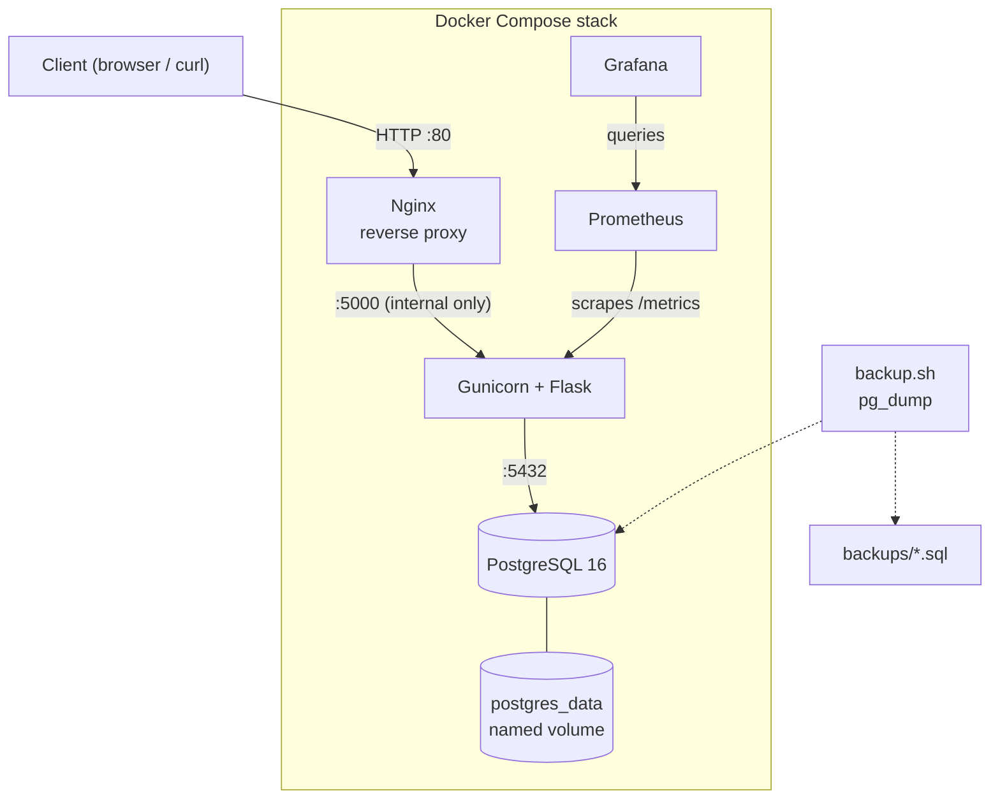
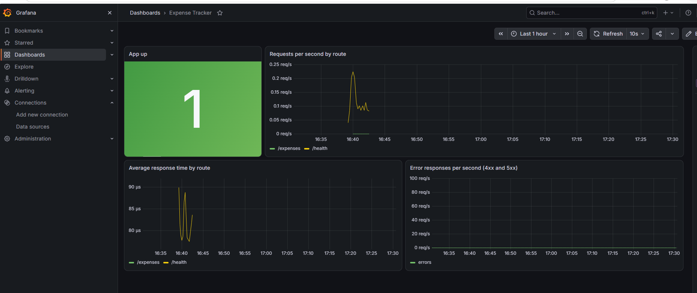

# Expense Tracker API

A containerized REST API for tracking expenses, built with Flask and PostgreSQL and served through Gunicorn and Nginx. It includes automated tests, a CI/CD pipeline with Trivy image scanning that publishes to Docker Hub, Prometheus and Grafana monitoring, and a tested database backup and restore process.

## Architecture



All three services run in Docker Compose. Port 5000 is exposed only to the internal Docker network, so the app can be reached only through Nginx.

## Technologies

- Python, Flask, SQLAlchemy
- PostgreSQL 16
- Gunicorn (production WSGI server)
- Nginx (reverse proxy)
- Docker and Docker Compose
- pytest
- GitHub Actions and Docker Hub
- Trivy (image vulnerability scanning)
- Prometheus and Grafana (monitoring)

## API Endpoints

| Method | Path | Description |
|--------|------|-------------|
| GET | `/` | API status message |
| GET | `/health` | Health check |
| POST | `/expenses` | Create an expense (`title`, `amount`, `category`) |
| GET | `/expenses` | List all expenses |
| GET | `/expenses/<id>` | Get one expense |
| PUT | `/expenses/<id>` | Update an expense |
| DELETE | `/expenses/<id>` | Delete an expense |

Missing fields on `POST` return `400` with a message naming the missing fields.

## Running the Project

### 1. Clone the repository

```bash
git clone https://github.com/crypxw/expense-tracker.git
cd expense-tracker
```

### 2. Create a `.env` file

```text
POSTGRES_DB=expenses
POSTGRES_USER=postgres
POSTGRES_PASSWORD=<choose-a-password>
GRAFANA_ADMIN_PASSWORD=<choose-a-password>
```

The file must use Unix (LF) line endings. Windows (CRLF) endings add a hidden `\r` to each value and break the scripts.

### 3. Start the stack

```bash
docker compose up -d
docker compose ps
```

### 4. Try it

```bash
curl http://localhost/health

curl -X POST http://localhost/expenses \
  -H "Content-Type: application/json" \
  -d '{"title": "Lunch", "amount": 12.5, "category": "Food"}'

curl http://localhost/expenses
```

## Reliability

- Healthchecks on `web` (`/health`) and `db` (`pg_isready`)
- `web` waits for `db` to be healthy before starting
- `restart: unless-stopped` on all services
- Database data stored in the `postgres_data` named volume

## Testing

```bash
docker compose exec -T web python -m pytest
```

## CI/CD

The GitHub Actions workflow (`.github/workflows/ci.yml`):

1. Builds the Docker images
2. Scans the image with Trivy and fails the build on fixable HIGH or CRITICAL vulnerabilities
3. Starts the stack with Docker Compose
4. Runs pytest inside the `web` container
5. On push to `main`, logs into Docker Hub using GitHub Secrets and pushes the production image

## Backup & Restore

### Create a backup

```bash
./backup.sh
```

This loads `POSTGRES_USER` and `POSTGRES_DB` from `.env`, runs `pg_dump` inside the `db` container, and saves a timestamped file such as `backups/expense_tracker_20261008_183342.sql`. The `backups/` folder is gitignored.

### Restore from a backup

```bash
cat backups/<backup-file>.sql | docker compose exec -T db psql -U "$POSTGRES_USER" -d "$POSTGRES_DB"
```

The dump contains `CREATE TABLE`, so it restores into a database where the `expense` table does not exist yet.

### Tested recovery

The process was verified end to end: 23 rows were counted, the `expense` table was dropped, the data was restored from the backup, and the count returned to 23, with the ID sequence restored too.

## Monitoring

The stack includes Prometheus and Grafana.

- The Flask app exposes request counts and durations at `/metrics` (via `prometheus-flask-exporter`).
- Prometheus scrapes `web:5000/metrics` every 15 seconds over the internal Docker network.
- `/metrics` is blocked at Nginx (returns 404), so it is not reachable from outside the stack.
- Grafana reads from Prometheus. The data source and the "Expense Tracker" dashboard are provisioned from files in `grafana/`, so they load automatically on startup.

| Service | URL | Notes |
|---------|-----|-------|
| Grafana | http://localhost:3000 | Login `admin`, password from `GRAFANA_ADMIN_PASSWORD` in `.env` |
| Prometheus | http://localhost:9090 | Targets page shows the app as `UP` |

Both ports are published on `127.0.0.1` only. Add `GRAFANA_ADMIN_PASSWORD` to your `.env` (see `.env.example`).

The dashboard shows whether the app is up, requests per second by route, average response time, and the error rate.



Image versions are pinned (`prom/prometheus:v3.15.0`, `grafana/grafana:13.2.4`).

## Security Notes

- Secrets live in `.env` (gitignored) and GitHub Secrets, never in the repository
- The application port is not published to the host
- Backups and the SQLite fallback folder (`instance/`) are gitignored
- The application container runs as a non-root user
- Prometheus and Grafana are published on `127.0.0.1` only, and `/metrics` is blocked at Nginx